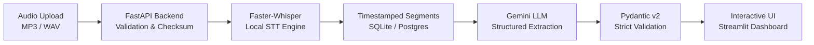

# AI Meeting Intelligence & Action Tracker

An end-to-end meeting intelligence system that converts audio recordings into verified transcripts, extracts structured meeting intelligence (executive summaries, confirmed decisions, action items with assignees/deadlines, risks, blockers, open questions, and participants), and powers grounded natural language Q&A.

---

## Architecture Overview



### End-to-End Workflow
1. **Audio Ingestion & Probe**: Multipart audio upload validated via PyAV (`av`) for valid headers, streams, file size (up to 100MB), and sha256 duplicate detection.
2. **Local Transcription**: Automated speech recognition using `faster-whisper` (`base` model on CPU with `int8` quantization) into timestamped segments.
3. **Structured Intelligence Extraction**: Prompted Google Gemini API requesting strict JSON output validated against Pydantic v2 models.
4. **Grounded Q&A**: Natural language questions answered strictly from the meeting transcript and extracted context; unsupported queries state that the meeting does not provide enough information.
5. **Persistence & UI**: SQLite database (with zero-friction local run) and responsive Streamlit web dashboard.

---

## Features

- **Audio Formats**: MP3 and WAV supported with real PyAV container validation.
- **Deduplication**: SHA-256 checksum tracking prevents accidental duplicate re-processing.
- **Local STT**: Fully local `faster-whisper` transcription without third-party audio API costs.
- **Structured Extraction**:
  - Executive Summary & Key Topics
  - Confirmed vs. Tentative/Superseded Decisions
  - Action Items (task, assignee, stated deadline phrase, priority, status, evidence quotes)
  - Risks (description, potential impact, evidence)
  - Blockers & Dependencies (owner, dependency, status, evidence)
  - Unresolved Items & Open Questions
  - Identified Participants & Roles
- **Grounded Q&A**: Answers questions only from that specific meeting; returns verified transcript evidence snippets.
- **Interactive UI**: Clean, responsive Streamlit web dashboard.

---

## Setup & Running Locally

### Prerequisites
- Python 3.11+ (Python 3.13 tested and verified)
- Windows PowerShell or macOS/Linux Terminal

### 1. Clone & Enter Project Directory

### 2. Create and Activate Virtual Environment
**Windows PowerShell:**
```powershell
python -m venv venv
.\venv\Scripts\Activate.ps1
```

### 3. Install Dependencies
```bash
pip install -r backend/requirements.txt
```

### 4. Configure Environment Variables
Copy `.env.example` to `.env`:
```powershell
Copy-Item .env.example .env
```

Edit `.env` and set your Gemini API key (optional for transcription and mock testing; required for live LLM extraction):
```env
GEMINI_API_KEY=your_actual_gemini_api_key_here
GEMINI_MODEL=gemini-2.5-flash
WHISPER_MODEL_SIZE=base
WHISPER_DEVICE=cpu
WHISPER_COMPUTE_TYPE=int8
```

### 5. Run Database Migrations
```bash
alembic -c backend/alembic.ini upgrade head
```

### 6. Start the Application

You can run the backend and the **Streamlit Web Dashboard**:

#### Option A: Run Both Backend & Streamlit Concurrently (Recommended)
From the `meeting-parser` root directory:
```powershell
python run.py --all
```
This starts the FastAPI backend on port 8000 and launches the Streamlit interface on port 8501.

#### Option B: Run Streamlit Interface Directly
```powershell
streamlit run streamlit_app.py
```

Open your browser at: **[http://localhost:8501](http://localhost:8501)**

#### Option C: Run FastAPI Backend Only
```powershell
python run.py
```
*Or from the `backend` directory:*
```powershell
cd backend
python -m uvicorn app.main:app --host 127.0.0.1 --port 8000 --reload
```
- API & Swagger Docs: **[http://127.0.0.1:8000/docs](http://127.0.0.1:8000/docs)**
- Health check: **[http://127.0.0.1:8000/api/health](http://127.0.0.1:8000/api/health)**

---

## REST API Reference

| Method | Endpoint | Description |
|---|---|---|
| `GET` | `/api/health` | Health status and non-secret provider configuration |
| `POST` | `/api/meetings/upload` | Multipart audio upload; starts processing pipeline |
| `GET` | `/api/meetings` | Paginated meeting list (`?page=1&page_size=20&status=&query=`) |
| `GET` | `/api/meetings/{id}` | Full meeting detail, transcript segments, and analysis |
| `POST` | `/api/meetings/{id}/query` | Ask grounded natural language question |
| `POST` | `/api/meetings/{id}/reprocess` | Re-run transcription and analysis pipeline |
| `DELETE` | `/api/meetings/{id}` | Delete meeting, transcript, analysis, and audio file |

Interactive Swagger documentation is available at: **[http://127.0.0.1:8000/docs](http://127.0.0.1:8000/docs)**

---

## API Examples

### Upload Recording
```powershell
curl -X POST "http://127.0.0.1:8000/api/meetings/upload" -F "file=@sample_audio.wav"
```

### Ask Grounded Question
```powershell
curl -X POST "http://127.0.0.1:8000/api/meetings/{MEETING_ID}/query" `
  -H "Content-Type: application/json" `
  -d '{"question": "What are the confirmed deadlines?"}'
```

---

## Model & Provider Rationale

1. **Audio Transcription (`faster-whisper`)**:
   - Uses CTranslate2 reimplementation of Whisper, up to 4x faster than original Whisper with significantly lower memory footprint.
   - Default configuration (`base` model, `cpu`, `int8`) executes smoothly on standard development machines without requiring a CUDA GPU.
   - Packaged behind `TranscriptionProvider` interface to permit cloud-hosted providers (e.g. Google Cloud Speech-to-Text) without changing application routes.

2. **LLM Extraction (`google-genai` / Gemini 2.5 Flash)**:
   - High speed, low latency, and native JSON mode (`response_mime_type="application/json"`).
   - Strict Pydantic validation with 1-attempt retry recovery loop.

---

## Privacy & Security

- Audio files are stored outside the public web root (`./storage/audio/`) with safe UUID prefixes.
- Checksums prevent duplicate disk and processing exhaustion.
- API keys are read from environment variables and never logged or committed to source control.
- Note: When `GEMINI_API_KEY` is configured, transcript text is submitted to Google's Gemini API for processing. For air-gapped deployments, an offline LLM provider (e.g., Ollama or local Llama) can be wired into `LLMAnalyzerProvider`.
